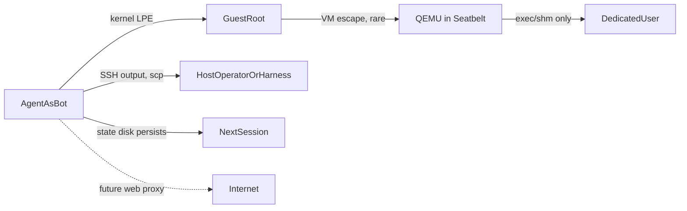

# Agent VM security assessment and quick wins

## Verdict

The setup is solid for this threat model. There are three independent layers between the agent and your data:

- **Inside the VM:** `bot` has no sudo, its password is locked, and it logs in with a key only.
- **QEMU itself:** the network uses `restrict=on`, there is no monitor or serial console, the OS disk runs with `snapshot=on`, and the only inbound path is SSH on 127.0.0.1:2222.
- **On the Mac:** QEMU runs under a `deny default` Seatbelt profile with no outbound network and filesystem access limited to `disks/`, all inside a dedicated user account.

A prompt-injected agent has no direct network path out. The realistic risks now are the channels you open on purpose (the SSH session, files you copy out, and future web access), persistence on the state disk, and a few hygiene gaps.

## Main exfiltration and execution paths, most likely first

1. **The SSH channel back to the host.** This is the only live data path. Whatever the agent prints or you `scp` out reaches the host. That includes terminal escape sequences (OSC 52 clipboard writes, hyperlinks, title injection) and malicious files that you later open on the host. It also matters what the host-side `ssh` client enables: `ForwardAgent`, `-R` remote forwards, or X11 would let the guest use host resources.
2. **Secrets you put in the VM.** Any API key or token given to the agent can be exfiltrated over any channel you open later. The VM can't protect secrets it was handed.
3. **Persistence on the state disk.** `noexec` only blocks running a binary directly. `bash x.sh`, `python3 x.py`, and `ld.so ./bin` all still work. Anything a later session reads and runs from `/home/bot/state` (git hooks, `.venv`, `.pth` files, agent configs, Makefiles) carries a prompt injection or payload across the snapshot reset. If the agent gets guest root, it can also write a crafted ext4 to that disk.
4. **Guest privilege escalation.** The base image can't get security updates at runtime because there's no network, so kernel bugs pile up between rebuilds. Guest root doesn't reach the host by itself, but it removes the in-guest boundary and lets the agent tamper with the state disk.
5. **QEMU escape** (low likelihood). After an escape, the Seatbelt profile still allows `process-exec*` of any binary and broad `ipc-posix-shm`, which is more than QEMU needs once it has started.
6. **Future web access** (from the to-dos in `checklist.md`). As soon as general outbound HTTP or DNS is added, exfiltration becomes trivial. This is the biggest future risk.

## Low-hanging fixes

### Repo and key hygiene
- In `.gitignore`, add `keys/`, `disks/`, `*.iso`, and `cidata/`. The private keys and disk images currently show up as untracked files, one `git add .` away from being committed.
- Both `keys/adminkey` and `keys/vmkey` have **no passphrase**. Add one to `adminkey` (`ssh-keygen -p -f keys/adminkey`) and keep it out of the `/Users/Shared` copy described in the `readme.md` workflow. Only the dedicated account's harness should hold `vmkey`.
- Make the shared copy of `qemu-sandbox.sb`, `start_vm.sh`, and `os_base.qcow2` owned by `luke` and read-only to the dedicated user, so an escaped process can't weaken the next run's profile.

### `start_vm.sh`
- Add `format=qcow2` to both `-drive` lines. Right now QEMU probes the format, and making the format explicit is standard hardening against format-confusion and backing-file tricks.
- Add `-nodefaults` (plus `-no-user-config`) so no implicit devices are attached. This shrinks the attack surface for an escape.
- Run QEMU with `exec` and `set -euo pipefail` so a failed `mkdir` doesn't silently start an unsandboxed or misconfigured VM.

### `qemu-sandbox.sb`
- Narrow `(allow process-exec* process-fork)` to the QEMU binary only, for example `(allow process-exec (literal "/opt/homebrew/bin/qemu-system-aarch64") (subpath "/opt/homebrew/Cellar/qemu"))` and keep `process-fork` for `-daemonize`. A process that escapes QEMU could then no longer start `/bin/sh` or `curl`.
- Remove the `/dev/hvf` write rule if HVF still works without it. Hypervisor.framework doesn't use that node on Apple Silicon.
- Check whether `ipc-posix-shm` can be scoped by name, for example `(ipc-posix-name-prefix "qemu")`, instead of being allowed globally.

### Host-side SSH into the VM
- In `~/.ssh/config` for the dedicated account, add a `Host agentvm` block with: `HostName 127.0.0.1`, `Port 2222`, `ForwardAgent no`, `ForwardX11 no`, `ClearAllForwardings yes`, `PermitLocalCommand no`, `StrictHostKeyChecking yes`, and a dedicated `UserKnownHostsFile`.
- Prefer non-interactive `ssh -T` for the harness, and treat output as untrusted. Strip control characters before showing it, and turn off OSC 52 clipboard writes in your terminal.
- Pull artifacts out as plain text or through a review step. Never mount the state qcow2 on the host or run files from it there.

### Guest (`vm-config.yaml`)
- Add `hidepid=2` to `/proc` and lock down `/home/vm_admin` (mode 700) so `bot` can't inspect admin processes or files.
- In `sshd_config.d`, add `AllowUsers bot vm_admin` and `AllowTcpForwarding no`, `X11Forwarding no`, `AllowAgentForwarding no`, `PermitTunnel no` for `bot`.
- Rebuild the base image regularly, as `readme.md` already plans. That's the only patch path for guest kernel bugs.
- Treat `/home/bot/state` as untrusted input in every session. Don't auto-source anything from it. Consider wiping or rotating the state disk per task when cross-session memory isn't needed.

### When adding web access later
- Don't use `restrict=off`. Keep `restrict=on` and add a single `guestfwd=tcp:10.0.2.100:3128-cmd:...` (or a host proxy reached through it) that enforces a domain **allowlist**, logs requests, and handles DNS itself so the guest never resolves arbitrary names (the attack in `lessons.md`).
- Give the agent narrowly scoped, short-lived credentials. Remember that any allowed domain that accepts user content (GitHub gists, pastebins, the LLM API itself) is a possible exfiltration endpoint.

## Already handled well (no change needed)
- `snapshot=on` OS disk with the overlay kept in a sandbox-only `TMPDIR`, and stale `vl.*` and `memfd-*` files cleaned up.
- No outbound network in the Seatbelt profile, plus `restrict=on`. DNS exfiltration was confirmed blocked in `lessons.md`.
- `-monitor none -serial none -display none`, and the forward bound to 127.0.0.1.
- Installation is separated from runtime, the format-only-if-blank logic for the state disk, and `nosuid,nodev,noexec` on the state mount.
